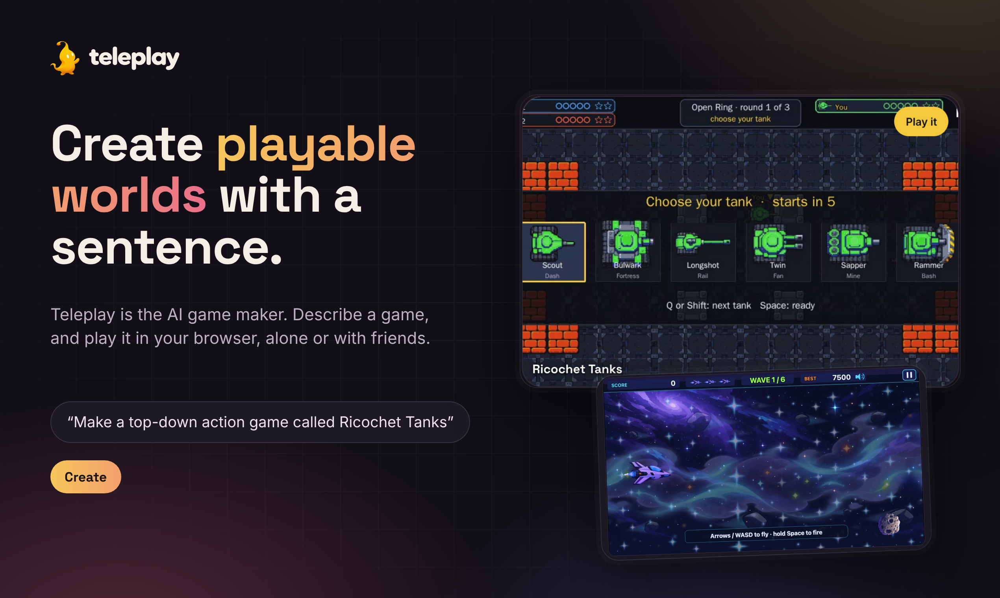
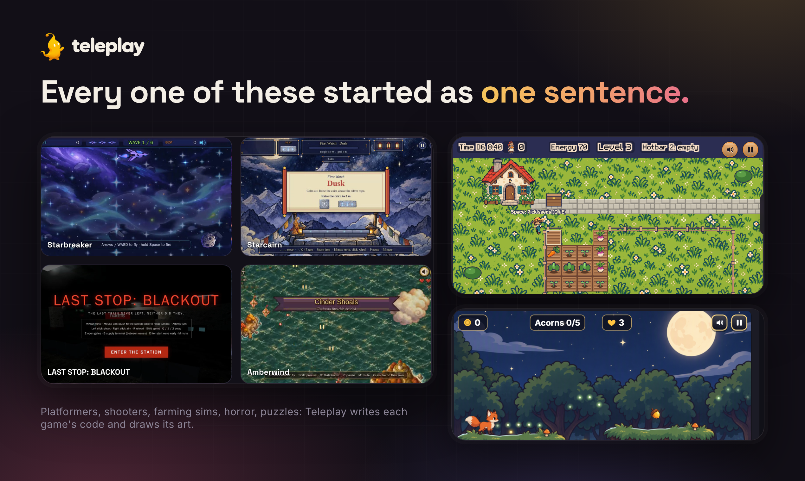
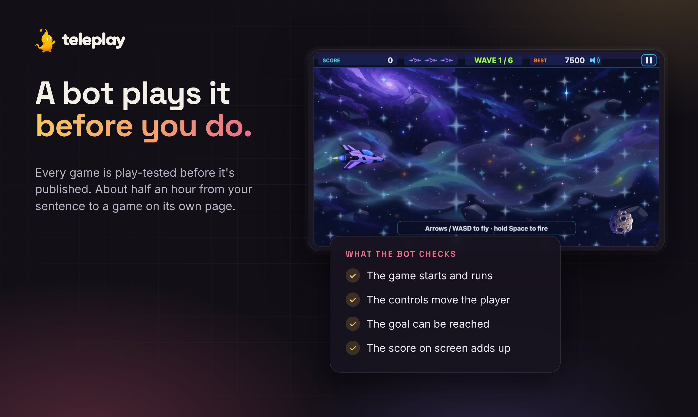
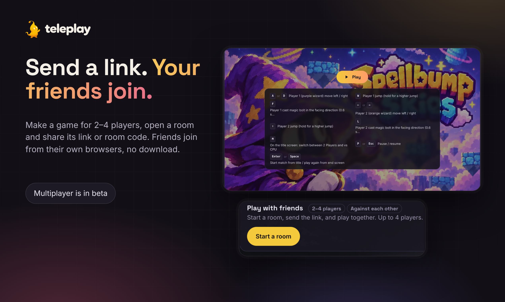
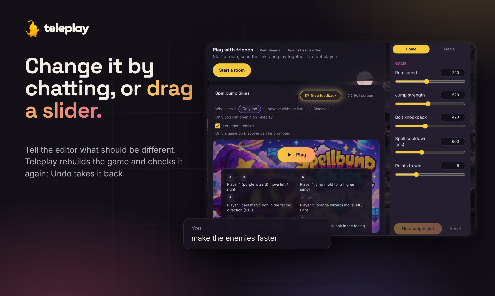
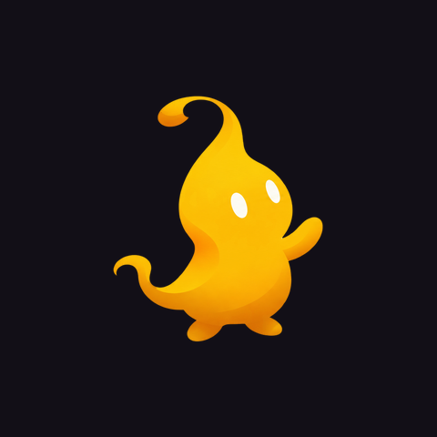

  

# Teleplay press kit

Everything here is free to use when you write about Teleplay: articles, reviews, videos, lists. Please keep the logo's colours and shape as they are. Questions: **info@teleplay.ai**.

## In one line

> **Teleplay is an AI game maker. Create playable worlds with a sentence.**

## Short description (147 characters)

> Teleplay is an AI game maker. Create playable worlds with a sentence: describe a game, then play it in your browser, alone or with friends by link.

## Longer description

> Teleplay is an AI game maker. Create playable worlds with a sentence: describe a game, and about half an hour later you play it in your browser, in 2D or 3D (beta). A bot plays every game before it reaches you, so what you get starts, can be won and can be lost. Games come with their own art, music and sound. Send a link and 2 to 4 friends join the same game, no install and no account to play. Change it by chatting: harder, a new level, a different hero.

## Türkçe

> **Teleplay bir yapay zekâ oyun yapıcısı. Tek cümleyle oynanabilir dünyalar yarat.** Bir oyunu anlat, sonra tarayıcında tek başına ya da arkadaşlarınla link üzerinden oyna.

## Screenshots

Click any image for the full size (2540 × 1520).

| | |
|---|---|
|  |  |
| **Create playable worlds with a sentence** | **Every one started as one sentence** |
|  |  |
| **A bot plays it before you do** | **Send a link, your friends join** |
|  | |
| **Change it by chatting, or drag a slider** | |

## Logo

| | File | Use it for |
|---|---|---|
|  | [`logo/teleplay-mascot.png`](logo/teleplay-mascot.png) | The mascot, transparent background |
|  | [`logo/teleplay-icon.png`](logo/teleplay-icon.png) | Square icon, 480 × 480 |
| | [`logo/teleplay-wordmark.svg`](logo/teleplay-wordmark.svg) | The word "teleplay", vector, for light or dark backgrounds |

**Please don't** stretch, recolour, outline or rotate the logo, or put it on a busy background.

## Colours and type

| | Hex | Where |
|---|---|---|
|  | `#F6C65B` | Sun yellow: highlights, buttons |
|  | `#F2A06E` | Peach: gradients |
|  | `#E9708A` | Rose: gradients, accents |
|  | `#120F17` | Night: backgrounds |
|  | `#F4EFE6` | Paper: text on dark |

Headlines are set in **Space Grotesk**, body text in **Inter**.

## Facts

| | |
|---|---|
| Name | Teleplay (where another Teleplay could be meant: **Teleplay AI**) |
| What it is | AI game maker: text to a playable browser game |
| Website | [teleplay.ai](https://www.teleplay.ai) |
| Company | Electrica, Inc. |
| Category | Games, game development, no-code |
| Languages | English, Turkish |
| Ages | 13 and up |

Teleplay is not the TV-script, short-drama or streaming tool that shares the name.

## Links

[Website](https://www.teleplay.ai) · [Discover](https://www.teleplay.ai/discover) · [X](https://x.com/teleplay_ai) · [YouTube](https://www.youtube.com/@teleplay.ai-youtube) · [Instagram](https://www.instagram.com/teleplay.ai/) · [TikTok](https://www.tiktok.com/@teleplay.ai) · [LinkedIn](https://www.linkedin.com/company/teleplay-ai) · [Product Hunt](https://www.producthunt.com/products/teleplay-ai)
